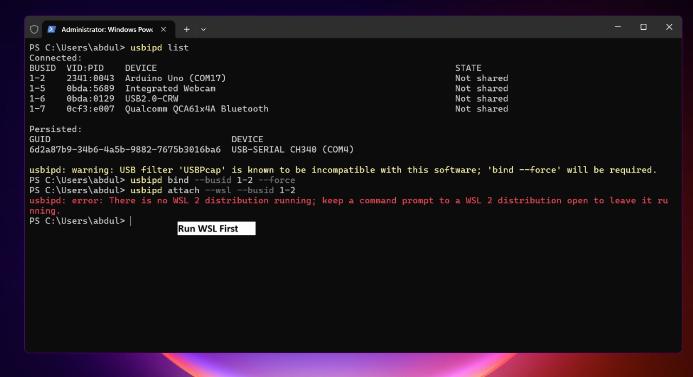
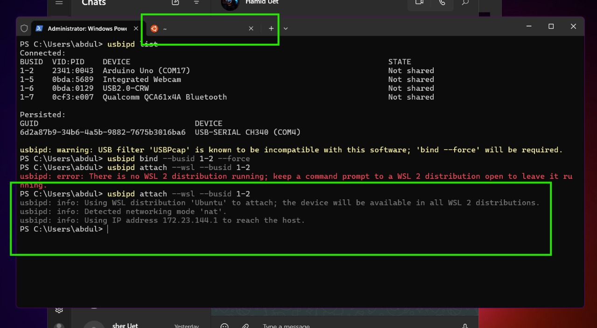

# Arduino AVR Assembly Project

This project demonstrates programming an Arduino UNO microcontroller using AVR assembly language. The code implements a simple counter that increments values on PORTB, causing the built-in LED (connected to pin 13/PB5) to blink.

## Overview

Assembly language provides direct control over the microcontroller's hardware, enabling precise timing and efficient code execution. This project serves as a starting point for AVR assembly programming on Arduino boards using the AVRA assembler on Linux systems.

## Prerequisites

### Hardware

- Arduino UNO board
- USB-A to B Cable for programming

### Software

- AVRA assembler (Linux equivalent to Atmel's avrasm2)
- avrdude (programmer software)

### Using WSL for Arduino Development

#### WSL Installation

1. Install WSL by running the following command as administrator in PowerShell:

   ```bash
   wsl --install
   ```

   This will install the default Ubuntu distribution.

   ```bash
   wsl --install -d Ubuntu
   ```

2. After installation completes, you'll need to restart your computer.

3. Upon restart, the Linux distribution setup will begin. Create a username and password when prompted.

4. Update your Linux distribution:
   ```bash
   sudo apt update && sudo apt upgrade -y
   ```

#### Connecting Arduino to WSL

To enable USB device access from WSL to your Arduino, follow these steps:

1. Install `usbipd` on your Windows host machine:

   ```bash
   winget install usbipd
   ```

   [SCREENSHOT: usbipd installation in Windows]

2. Ensure WSL is running before attempting to use usbipd. If you try to bind devices before starting WSL, you'll receive an error:

   ```bash
   wsl --status
   ```

   If WSL isn't running, start it with:

   ```bash
   wsl
   ```

   [SCREENSHOT: Starting WSL before binding devices]
   ]

3. List available USB devices to identify your Arduino:

   ```bash
   usbipd list
   ```

   Look for the Arduino device in the list and note its `BUSID` (e.g., `1-2`).

   [SCREENSHOT: usbipd list showing Arduino device[]]

4. Bind the Arduino device to make it accessible to WSL:

   ```bash
   usbipd bind --busid <BUSID>
   ```

   [SCREENSHOT: binding Arduino device to WSL]

5. Attach the device to your WSL instance:

   ```bash
   usbipd attach --wsl --busid <BUSID>
   ```

   [SCREENSHOT: attaching Arduino device to WSL]

6. In your WSL terminal, verify the Arduino is available:

   ```bash
   ls /dev/tty*
   ```

   You should see your Arduino listed (often as `/dev/ttyACM0`).

   [SCREENSHOT: WSL terminal showing Arduino device]

Replace `<BUSID>` with the actual BUSID of your Arduino device from step 2. Once attached, the Arduino will be accessible within your WSL environment and ready for development.

Note: You'll need to repeat the binding and attaching steps each time you reconnect your Arduino or restart your computer.

## Installation

To install the required software on Debian-based Linux distributions:

```bash
sudo apt install avra avrdude -y
```

To verify if you have the tools installed:

```bash
which avra
which avrdude
```

## Project Structure

- `main.asm` - Main assembly source file containing the LED blinking logic
- `include/` - Directory containing macro and definition files:
  - `m328pdef.inc` - ATmega328P microcontroller register definitions
  - `1602_LCD_Macros.inc` - Macros for controlling 16x2 LCD displays
  - `16bit_reg_read_write_Macro.inc` - Macros for 16-bit register operations
  - `UART_Macros.inc` - Macros for UART serial communication
  - `delay_Macro.inc` - Macros for generating time delays
  - `div_Macro.inc` - Macros for division operations
- `Makefile` - Builds and flashes the project
- `.gitignore` - Specifies files to ignore in version control

## Building the Project

To compile the assembly code into a hex file:

```bash
make
```

This runs AVRA to assemble the code and generate the `main.hex` file that can be uploaded to the Arduino.

## Uploading to Arduino

### Finding Your Arduino Device

Connect your Arduino to your computer via USB and run:

```bash
ls /dev/tty*
```

Look for entries like `/dev/ttyACM0` (common for Arduino UNO) or `/dev/ttyUSB0` (common for Arduino clones with CH340 chips). You'll need to update the device path in the Makefile or command line if your device shows up at a different location.

### Flashing the Arduino

Using the Makefile:

```bash
make flash
```

Or manually:

```bash
avrdude -p atmega328p -c arduino -P /dev/ttyACM0 -U flash:w:main.hex:i
```

Replace `/dev/ttyACM0` with the correct device path for your Arduino.

## Additional Resources

- [AVRA GitHub Repository](https://github.com/Ro5bert/avra)
- [ATmega328P Datasheet](https://ww1.microchip.com/downloads/en/DeviceDoc/Atmel-7810-Automotive-Microcontrollers-ATmega328P_Datasheet.pdf)
- [AVR Instruction Set](https://ww1.microchip.com/downloads/en/devicedoc/atmel-0856-avr-instruction-set-manual.pdf)

## Credits

Macro files in the `include/` directory were created by:

- Syed Tehseen ul Hasan Shah, Lecturer, University of Engineering and Technology Lahore [github](https://github.com/tehseenhasan)

## License

This project is open source and available for educational purposes.
